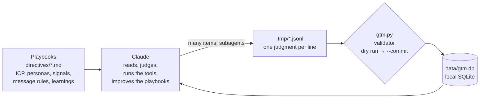

# Sales for solopreneurs

**Run B2B sales like a team of five, as a team of one.** A Claude Code plugin that builds
a small, local sales system in a folder on your laptop: who to sell to, when they are
ready, who to talk to, what to say, and what to do today. Your data stays in one SQLite
file on your machine.

> A starter kit for your own agentic sales: a ready workspace with playbooks, a local
> database and tools. You and Claude run it together and improve it every week.

## Install

You need [VS Code](https://code.visualstudio.com) with the
[Claude Code extension](https://code.claude.com/docs/en/vs-code), and Python 3.9+
(preinstalled on macOS and most Linux). No other packages.

**1. Install the plugin (once).** In VS Code, open a terminal (**Terminal → New Terminal**)
and run these 2 commands:

```
claude plugin marketplace add ostkam/sales-solopreneurs
claude plugin install sales@sales-solopreneurs
```

The `/plugin` command does not work in the VS Code chat panel; these terminal commands do
the same thing. *Using Claude Code in a terminal instead?* There you can also type
`/plugin marketplace add ostkam/sales-solopreneurs` and `/plugin install sales@sales-solopreneurs`.

**2. Open a new Claude chat.** A chat that was already open does not see the new plugin.
Close the Claude panel and open it again (or run **Developer: Reload Window**).

**Update to the latest version** later with:

```
claude plugin marketplace update sales-solopreneurs
claude plugin update sales@sales-solopreneurs
```

You also need LinkedIn (Sales Navigator helps, but is not required). Everything goes in by
copy-paste, never scraping.

## Start (10 minutes)

1. Make an empty folder (for example `my-sales`) and open it in VS Code (**File → Open Folder**).
2. Open the Claude panel and type:

```
start
```

(or `/sales:start`). Claude guides you through everything below, one step at a time, and
waits for your "go" between steps:

1. builds the workspace and the database, and opens a live view of it in your browser;
2. reads your website to learn your business;
3. fills your ideal customer profile from it, then asks you 5 short questions;
4. does the same for the people you sell to;
5. helps you pick your first buying signal and tests it (hiring is the built-in example);
6. writes your first LinkedIn connection note.

After that, just say what you want ("find companies hiring bookkeepers that fit my ICP",
"what should I do today?", "start the CRM"); Claude picks the skill.

**If `start` is not recognised:** the plugin is not loaded in this chat. Check with
`claude plugin list` in the terminal that `sales@sales-solopreneurs` is enabled, then open
a new Claude chat.

## How it works



Three parts, each doing what it is good at:

| Part | Where | Job |
|---|---|---|
| Playbooks | `directives/` | What we do and why, plus what we learned. Plain Markdown. |
| Claude | the conversation | Judgment: is this company a fit, what is true about this person, what to write. |
| Tools | `gtm.py`, `site_read.py` | Everything exact: database, imports, validation, exports, reading websites. No AI inside. |

Safety rules built in: every write is a dry run first; Claude's judgments pass a validator
before they reach the database; imports never overwrite what you entered; a do-not-contact
list is checked on every import and export; disqualifying a company or sending anything
needs your yes.

## The skills

| Step | Skill | What it does |
|---|---|---|
| Guide | `start` | Runs the whole flow below step by step and waits for your go |
| Know your business | `read-website` | Reads a company site: what they sell, to whom, proof, regions, team, LinkedIn page, with the page for each fact |
| | `icp` | 11 fixed parameters, filled from your website, then 5 numbered questions |
| | `persona` | 8 parameters per buyer persona, same flow |
| Find who needs you now | `hiring-signal` | The worked example: "they hire X → pain Y → my offer Z"; job ads in, qualified accounts out |
| | `signal-builder` | Define your own buying signals with AI: spec, test batch, yield, keep or stop |
| Reach out | `linkedin` | People from a Sales Navigator paste, then a connect note (no pitch) and a follow-up DM after they accept |
| Every day | `pipeline` | What to do today, and the live local CRM view |

## Your workspace

```
CLAUDE.md / AGENTS.md   how the workspace runs (Claude reads this every session)
directives/             your playbooks (edit them freely)
directives/signals/     one spec per buying signal you define
data/gtm.db             your database (git-ignored)
input/                  pastes you drop in (job ads, people lists)
.tmp/                   website reads, research lines, drafts (safe to delete)
gtm.py                  shortcut: python3 gtm.py status | pipeline | ui | query "select ..."
```

**See your data:** `python3 gtm.py ui` (or just ask Claude to "start the CRM") opens a
live, read-only view in your browser:

| Tab | What it shows |
|---|---|
| Profile | Your company (name and logo from your website), your ICP, fit rule, personas and background, each parameter marked confirmed / please check / missing |
| Today | What to do now: replies, follow-ups, drafts ready, new signals |
| Accounts | Companies grouped by fit, with signals and people |
| Contacts | People by stage, from not contacted to meeting, with profile facts and drafts |
| Signals | Every buying signal, with its date and source |

It runs on your computer only (`localhost`), loads nothing from the internet, and refreshes
by itself while Claude works. The Profile tab reads your playbooks directly, so edit
`directives/icp.md` and the page follows. Changes to data still go through Claude and the
validator, never through the page.

## Privacy

Everything runs locally. The plugin has no telemetry and sends nothing anywhere. The live view
runs on `127.0.0.1` and loads nothing from the internet. The only
network calls are the website reader (it fetches the public pages you ask for) and the web
research Claude does on companies. `data/`, `.tmp/` and `.env` are git-ignored by default.
Respect LinkedIn's terms: paste, do not scrape.

## Feedback

Built something with it? Share it in [Discussions](../../discussions) ("Show what you
built"). Found a bug? Open an issue.

---

Made by Kamil Ostrowski ([LinkedIn](https://www.linkedin.com/in/kamil-ostrowski)). MIT license.
